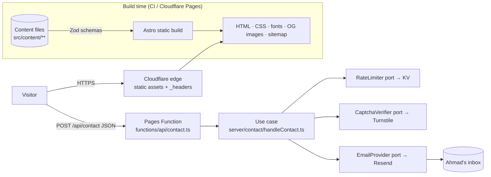

# Ahmad Hamarsheh — Portfolio

Bilingual (English / Arabic, full RTL) portfolio for **Ahmad Hamarsheh, Senior Backend Engineer**.
Static-first, content-as-data, secure contact form, and a CI pipeline that blocks merges on any failed check.

- **Live:** https://ahmadhamarsheh.pages.dev (custom domain-ready)
- **Stack:** Astro 7 · TypeScript (strict) · Tailwind CSS 4 · Cloudflare Pages + Pages Functions · Resend · Cloudflare Turnstile
- **Quality bar:** Lighthouse ≥ 95 in every category (enforced in CI), WCAG 2.1 AA (axe in CI), responsive from 320 px

---

## Architecture



**Why static-first:** there is no server or database to attack, every page is served from Cloudflare's CDN, and
the site cannot "go down" under load. The only dynamic piece is one small function for the contact form.

### Design principles — where they live

| Principle                         | Where                                                                                                                                                                                                 |
| --------------------------------- | ----------------------------------------------------------------------------------------------------------------------------------------------------------------------------------------------------- |
| **Open/Closed — content as data** | A new job, case study, service or skill group is a new Markdown file in `src/content/<collection>/{en,ar}/`. Zero code changes. Schemas in `src/content.config.ts` validate every file at build time. |
| **Single Responsibility**         | One component per section (`src/components/sections/*`); content queries in `src/lib/content.ts`; pure logic in `src/lib/experience.ts`; HTTP in `functions/`; business rules in `server/`.           |
| **Dependency Inversion**          | `handleContact` depends only on ports (`server/contact/ports.ts`). Adapters (Resend, Turnstile, KV) are wired in the composition root `functions/api/contact.ts`.                                     |
| **Strategy / Adapter**            | `EmailProvider`: `ResendEmailProvider` in production, `ConsoleEmailProvider` locally. Switching to SES/Mailgun is one new class.                                                                      |
| **Shared validation**             | `src/lib/contact/validation.ts` runs in the browser (instant feedback) and on the server (source of truth). No dependencies.                                                                          |
| **i18n layer**                    | No hard-coded UI strings: `src/i18n/ui.ts` is typed so a missing translation fails compilation; content has one file per language.                                                                    |

### Folder structure

```
src/
  content/                 # content as data (en/ + ar/ per collection)
    profile/  experience/  case-studies/  services/  skills/
  content.config.ts        # Zod schemas, incl. diagram integrity checks
  i18n/                    # typed UI dictionaries + routing helpers
  components/
    layout/                # Header, Footer, SeoHead
    sections/              # Hero, Work, Experience, Services, About, Contact
    case-study/            # CaseStudyBody, CaseStudyCard, ArchitectureDiagram (SVG from data)
    ui/                    # Icon, LinkButton, SectionHeading
  layouts/BaseLayout.astro # <html lang dir>, fonts, SEO, theme
  lib/                     # content queries, pure logic, contact validation, JSON-LD
  pages/                   # /, /ar/, /work/[slug], /ar/work/[slug], /cv/, /og/*.png, robots.txt, 404
  scripts/                 # progressive enhancement (theme, menu, contact form)
  views/                   # page compositions shared by EN and AR routes
server/                    # framework-free backend logic (ports, use case, adapters)
functions/api/contact.ts   # Cloudflare Pages Function (composition root)
public/                    # _headers (CSP/HSTS…), favicon, theme-init.js, cv/*.pdf
tests/unit/                # Vitest: validation, use case, adapters, i18n, content parity
tests/e2e/                 # Playwright: smoke, RTL, theme, contact form, 320px, axe
```

---

## Adding or changing content

| To…                       | Do this                                                                                                                                                                                                                     |
| ------------------------- | --------------------------------------------------------------------------------------------------------------------------------------------------------------------------------------------------------------------------- |
| Add a job                 | Copy a file in `src/content/experience/en/`, edit it, then add the Arabic twin in `.../ar/` with the same file name and `key`.                                                                                              |
| Add a case study          | Same pattern in `src/content/case-studies/`. The diagram is data: `nodes`, `edges` (polyline points) and numbered `markers`. The build fails if an edge points to an unknown node or a decision points to a missing marker. |
| Edit hero, about, metrics | `src/content/profile/en.md` and `ar.md`.                                                                                                                                                                                    |
| Edit UI labels            | `src/i18n/ui.ts` (both languages).                                                                                                                                                                                          |
| Update the CV PDF         | `npm run build && npm run cv:pdf`, then commit `public/cv/Ahmad-Hamarsheh-CV.pdf`. The PDF is printed from `/cv/`, which uses the same content as the site.                                                                 |

A unit test fails if a file exists in one language but not the other.

---

## Local development

Requirements: Node 22 (see `.nvmrc`).

```bash
npm ci
npm run dev                 # http://localhost:4321 — static site with hot reload
```

To exercise the real contact function locally (Turnstile test keys, email printed to the console):

```bash
cp .dev.vars.example .dev.vars
npm run dev:functions       # http://localhost:8788
```

### Quality checks

```bash
npm run lint                # ESLint (TypeScript + Astro)
npm run format:check        # Prettier
npm run typecheck           # astro check + worker tsconfig
npm test                    # Vitest unit tests
npm run build
npm run test:e2e            # Playwright (desktop + mobile) incl. axe accessibility scans
npm run lhci                # Lighthouse CI, asserts ≥ 95 in every category
npm run check:all           # everything above except Lighthouse
```

Set `CHROME_PATH` to use an installed Chrome instead of Playwright's Chromium.

---

## Security

- **Strict headers** (`public/_headers`): CSP without `unsafe-inline` (no inline scripts or styles are emitted — the
  build is configured to keep it that way), HSTS, `X-Frame-Options: DENY`, `Referrer-Policy`, `Permissions-Policy`, COOP.
- **Contact form defence in depth:** Origin check · JSON-only · 16 KB body limit · honeypot · shared validation and
  sanitisation · per-IP rate limit (KV) · Cloudflare Turnstile (server-side verification, action-bound) ·
  header-injection-safe subject · HTML-escaped email body · idempotency key so a double submit sends one email.
- **No secrets in the repo.** Keys live only in Cloudflare environment variables; `.dev.vars` and `.env` are git-ignored.
- **Supply chain:** `npm audit` (high/critical fail CI), dependency review on PRs, CodeQL, Dependabot.

## Deployment

Cloudflare Pages builds `main` on every push and creates a preview URL for every pull request.
