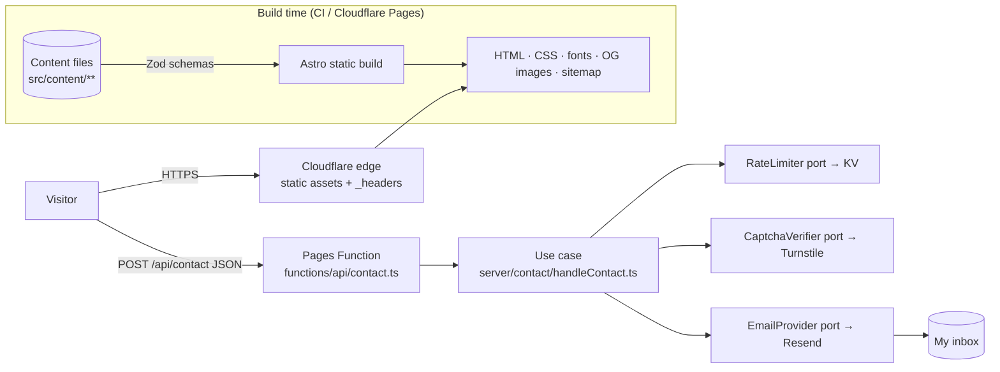

# Portfolio

The source of my site, [ahmadhamarsheh.pages.dev](https://ahmadhamarsheh.pages.dev). It's bilingual (English and Arabic with full RTL), static-first, and every change goes through CI before it can merge. CI enforces Lighthouse 95+ in every category and runs axe accessibility checks (WCAG 2.1 AA).

**Stack:** Astro 7 · TypeScript (strict) · Tailwind CSS 4 · Cloudflare Pages and Pages Functions · Resend · Cloudflare Turnstile

## Architecture



I kept the site static: there's no server or database to attack, every page comes from Cloudflare's CDN, and nothing falls over under load. The only dynamic part is a small function behind the contact form.

### How the code is organised

| Principle                     | Where                                                                                                                                                                                                          |
| ----------------------------- | -------------------------------------------------------------------------------------------------------------------------------------------------------------------------------------------------------------- |
| Content as data (Open/Closed) | Every job, case study, service and skill group is a Markdown file in `src/content/<collection>/{en,ar}/`. Zod schemas in `src/content.config.ts` validate them at build time, so adding one needs no new code. |
| Single responsibility         | One component per section, content queries in `src/lib/content.ts`, pure logic in `src/lib/experience.ts`, HTTP in `functions/`, business rules in `server/`.                                                  |
| Dependency inversion          | `handleContact` only knows its ports (`server/contact/ports.ts`). The Resend, Turnstile and KV adapters are wired in `functions/api/contact.ts`.                                                               |
| Strategy / adapter            | `ResendEmailProvider` in production, `ConsoleEmailProvider` locally. Moving to SES or Mailgun means one new class.                                                                                             |
| Shared validation             | `src/lib/contact/validation.ts` runs in the browser for instant feedback and on the server as the source of truth.                                                                                             |
| Typed i18n                    | `src/i18n/ui.ts` is typed, so a missing translation fails the build. Content has one file per language.                                                                                                        |

## Content

- To add a job, case study or service, copy a file in `src/content/<collection>/en/` and add the Arabic file with the same name and `key` in `ar/`. A unit test fails if one language is missing.
- Case study diagrams are data (`nodes`, `edges`, numbered `markers`). The build fails on a broken reference.
- The CV PDF is printed from `/cv/`, which uses the same content as the site. Run `npm run build && npm run cv:pdf`, then commit `public/cv/Ahmad-Hamarsheh-CV.pdf`.

## Running it locally

Node 22 (see `.nvmrc`).

```bash
npm ci
npm run dev             # http://localhost:4321
npm run check:all       # lint, format, types, unit tests, build and end-to-end tests
npm run lhci            # Lighthouse
```

To run the real contact function locally, copy `.dev.vars.example` to `.dev.vars` and run `npm run dev:functions`. It uses Turnstile test keys and prints the email to the console.

## Security

- Strict headers in `public/_headers`: CSP without `unsafe-inline` (the build emits no inline scripts or styles), HSTS, `X-Frame-Options: DENY`, `Referrer-Policy`, `Permissions-Policy` and COOP.
- The contact form checks the origin, accepts JSON only up to 16 KB, and uses a honeypot, the shared validation, a per-IP rate limit in KV and server-side Turnstile verification. The subject is safe from header injection, the body is HTML-escaped, and an idempotency key makes a double submit send one email.
- No secrets in the repo. Keys live in Cloudflare environment variables, and `.dev.vars` and `.env` are git-ignored.
- `npm audit` (high and critical fail CI), dependency review, CodeQL and Dependabot.

Cloudflare Pages builds `main` on every push and gives each pull request its own preview URL.
